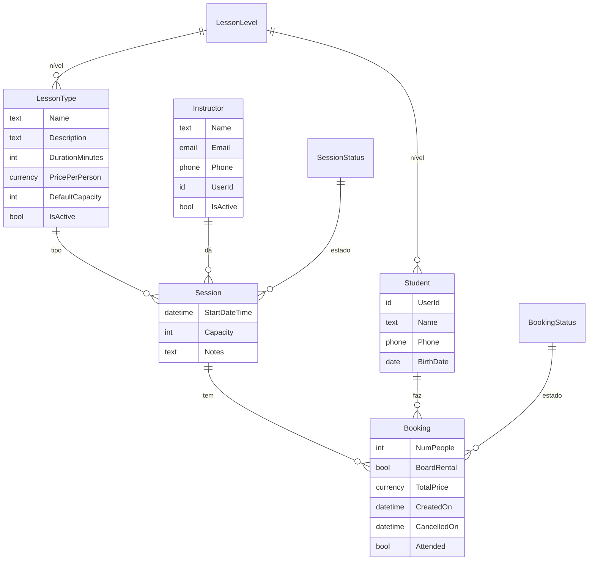

# Escola de Surf — App de marcação de aulas (OutSystems)

Aplicação de gestão e marcação de aulas para uma escola de surf fictícia, desenvolvida em **OutSystems** para consolidar modelo de dados, lógica de negócio, roles e integrações.

> **Estado:** em desenvolvimento — ver [Roadmap](#roadmap).
> Projeto irmão: site de reservas para o mesmo domínio em React + TypeScript + Supabase.

**Plataforma:** OutSystems 11 (O11) — Service Studio / Service Center
**Arquitetura:** módulos por camada — `SurfSchool_Core` (entities e lógica), `SurfSchool_IS` (integrações REST), `SurfSchool` (UI)

---

## Funcionalidades

| Role | O que pode fazer |
|---|---|
| **Aluno** | Ver sessões disponíveis, filtrar por data e nível, reservar, cancelar e consultar as suas reservas |
| **Instrutor** | Ver as suas sessões do dia/semana e marcar presenças |
| **Admin** | Gerir tipos de aula, instrutores e sessões; consultar ocupação e receita |

---

## Modelo de dados



**Static Entities:** `LessonLevel` (Iniciação, Intermédio, Avançado — com atributo `Order` para comparar níveis), `SessionStatus` (Agendada, Cancelada, Concluída), `BookingStatus` (Confirmada, Cancelada, ListaEspera).

### Decisões de modelação

- **`IsActive` em vez de apagar** — instrutores e tipos de aula inativos deixam de aparecer para novas marcações, mas o histórico de sessões e reservas mantém-se íntegro.
- **`TotalPrice` guardado na reserva** — o preço fica fixado no momento da marcação; alterações futuras de preço não mudam reservas já feitas nem os relatórios de receita.
- **Delete Rules** — _(a completar: Protect / Delete / Ignore para `Booking.SessionId`, `Session.InstructorId`, `Session.LessonTypeId`, com justificação)_

---

## Regras de negócio

Toda a lógica de reservas está em Server Actions no Core (`Booking_Create`, `Booking_Cancel`). As violações de regra lançam uma **User Exception** com mensagem clara, tratada no ecrã, e nada é gravado.

1. **Capacidade** — a soma de pessoas das reservas confirmadas mais a nova reserva não pode exceder a capacidade da sessão.
2. **Sem duplicados** — um aluno não pode ter duas reservas ativas na mesma sessão.
3. **Nível** — um aluno não pode reservar uma aula de nível superior ao seu (comparação por `LessonLevel.Order`).
4. **Sobreposição de instrutor** — um instrutor não pode ter sessões sobrepostas (`novoInício < fimExistente E novoFim > inícioExistente`).
5. **Preço** — função `CalculatePrice`: preço base × pessoas; +10 € por pessoa com aluguer de prancha; −15 % para menores de 12 anos.
6. **Cancelamento** — só até 24 h antes do início; regista `CancelledOn`.
7. **Sessão cancelada pelo admin** — cancela automaticamente todas as reservas dessa sessão.

### Segurança

- Permissões por role em cada ecrã **e** verificação de role na lógica de servidor (esconder botões não chega).
- Os dados do aluno são sempre filtrados pelo utilizador autenticado (`GetUserId()`), para que não seja possível aceder a reservas de outros alterando parâmetros no URL.

---

## Integrações e processos automáticos

- **REST (consumo):** previsão de ondulação (Open-Meteo Marine) no detalhe da sessão, com tratamento de falha da API.
- **REST (exposição):** `GET /sessions/available?date=...` — sessões com lugares livres.
- **Timer diário:** marca sessões passadas como Concluídas e cancela sessões com menos de 2 pessoas a 24 h do início.
- **Lista de espera:** quando há um cancelamento, a primeira reserva em espera passa a Confirmada, se couber.

---

## Roadmap

- [ ] **Fase 1** — Back-office (CRUD) para tipos de aula, instrutores e sessões _(em curso)_
- [ ] **Fase 2** — Regras de negócio de reserva e cancelamento
- [ ] **Fase 3** — Utilizadores, roles e áreas do aluno e do instrutor
- [ ] **Fase 4** — Block reutilizável `SessionCard` e dashboard de ocupação/receita
- [ ] **Fase 5** — Integrações REST, Timer e lista de espera
- [ ] **Fase 6** — Revisão de qualidade, separação Core / UI, debugging e logs

---

## Estrutura do repositório

```
├── README.md
├── docs/
│   └── progresso.md     # registo de progresso por fase
├── screenshots/         # ecrãs da app, modelo de dados, lógica
└── export/              # export da aplicação (.oml / .oap), quando disponível
```

> O código OutSystems é visual e versionado pela própria plataforma. Este repositório documenta o projeto e guarda os exports e as capturas de ecrã.

---

## Autor

**Rui Passos** — OutSystems Associate Developer (O11)
[LinkedIn](https://www.linkedin.com/in/rui-passos/) · [GitHub](https://github.com/Rui-Passos)
